<p align="center">
  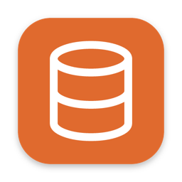
</p>

<h1 align="center">DBForge</h1>

<p align="center">
  A fast, lightweight desktop app for your databases.<br>
  PostgreSQL, MySQL, MariaDB, SQLite, SQL Server, MongoDB, Cosmos DB and Redis — in one window.<br>
  Query them, browse and edit their data, see their structure, and move data in and out.
</p>

<p align="center">
  <a href="https://github.com/Juan-Motta/dbforge/releases/latest">
    <picture>
      <source media="(prefers-color-scheme: dark)" srcset="docs/images/download-dark.svg">
      
    </picture>
  </a>
  <br>
  <sub>Signed &amp; notarized · updates itself</sub>
</p>

<p align="center">
  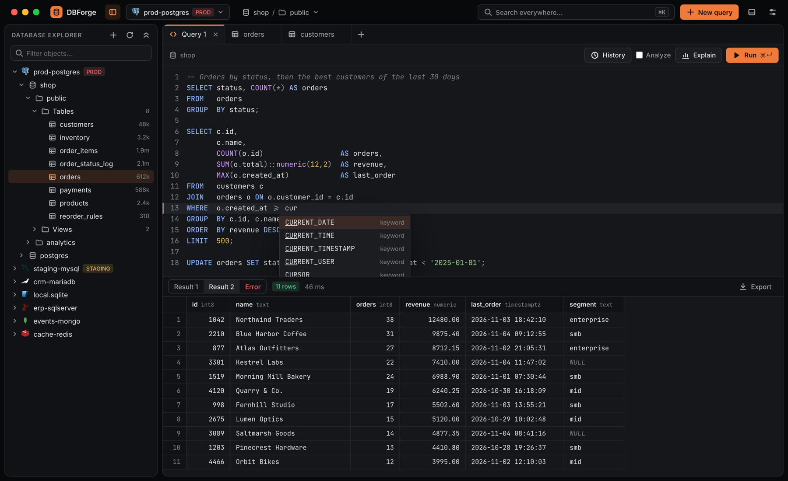
</p>

> The screenshots come from the app's design canvas, which the app follows.

## Install

1. Download `DBForge-x.y.z.dmg` from the [latest release](https://github.com/Juan-Motta/dbforge/releases/latest).
2. Open it and drag **DBForge** to **Applications**.

DBForge runs on Apple silicon and Intel Macs with **macOS 10.13** or later. It's signed and notarized by Apple.

## Works with your databases

| Database | What you get |
| --- | --- |
| **PostgreSQL** | Everything: the console with explain plans, table editing, structure and DDL, the ER diagram, and dumps and restores with `pg_dump` and `psql` |
| **MySQL** and **MariaDB** | The console, table editing, structure, DDL and the ER diagram |
| **SQL Server** | The same |
| **SQLite** | The same, on a database file |
| **MongoDB** | Collections as rows or as JSON documents, and a console that speaks mongosh |
| **Cosmos DB** | Containers as rows or as JSON items, and a SQL console per container |
| **Redis** | A key browser by pattern and type, each type's editor, and a redis-cli console |

Reach servers through an **SSH tunnel** — with a password, a private key or your SSH agent — and choose how **SSL** is used: from off to verifying the server's certificate and name, with your own CA and client certificates. Passwords stay in the macOS keychain, or in an encrypted file if you choose. Tag a connection as **PROD** and DBForge asks before anything changes it.

## Updates

DBForge checks for a new version once a day and shows it with the release notes. **Install and Restart** downloads it, verifies its signature and relaunches. You can also check any time with **DBForge › Check for Updates…**, or turn the daily check off in **Settings › About**.

## What you can do

### Query

A console per tab with highlighting and completion. Run one statement or the whole script, see each result in its own tab, with timing and row counts, and export or copy them. A script that stops partway still shows what its earlier statements did.

### Browse and edit tables

Filter and order rows, edit cells in place, add, duplicate and delete rows, and review the SQL before it runs. Pending changes apply in one transaction: all of them or none. Foreign keys open the row they point to.

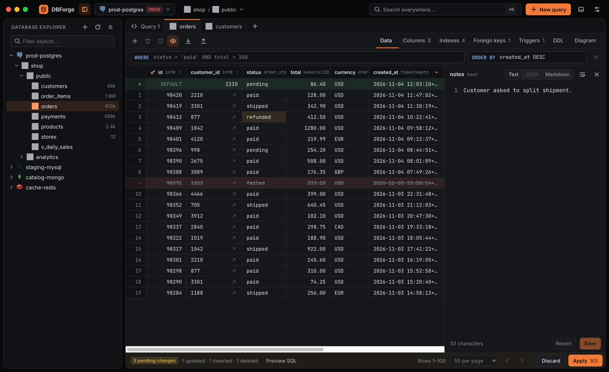

### Structure and relations

<table>
  <tr>
    <td width="50%" valign="top"><b>Structure</b> — columns, indexes, keys, triggers and the DDL that rebuilds the table<br><br>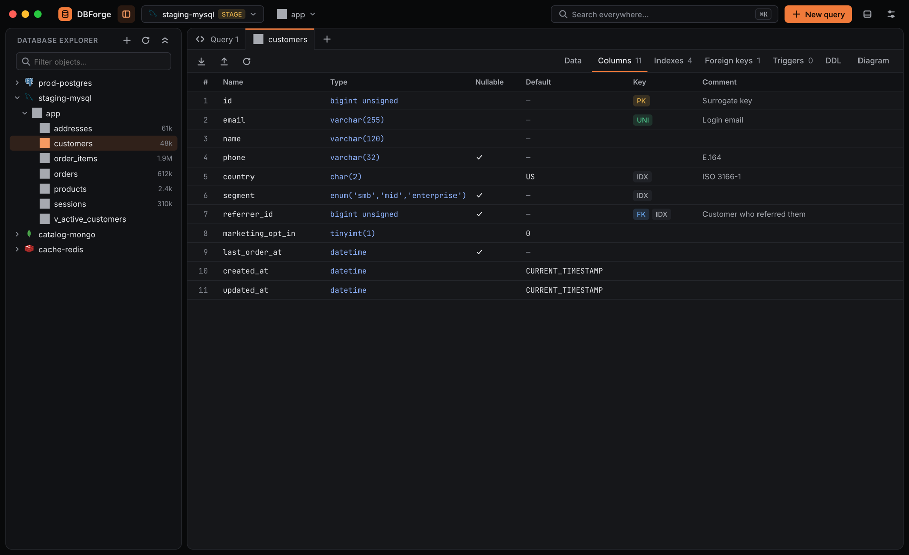</td>
    <td width="50%" valign="top"><b>ER diagram</b> — a schema's tables and the foreign keys between them<br><br>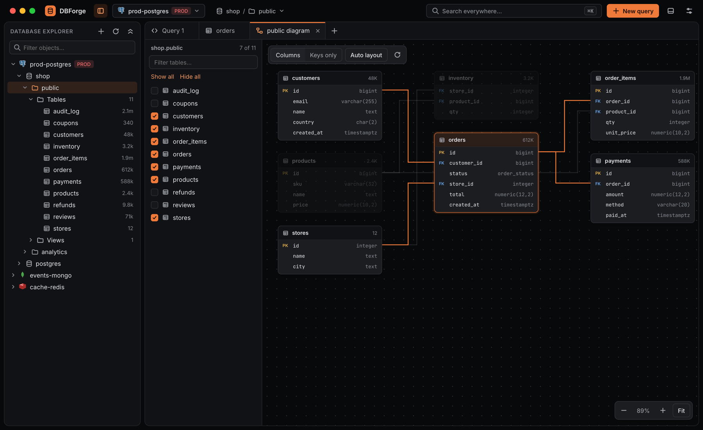</td>
  </tr>
  <tr>
    <td width="50%" valign="top"><b>Explain plans</b> — how a query runs, step by step, with its costs and timings<br><br>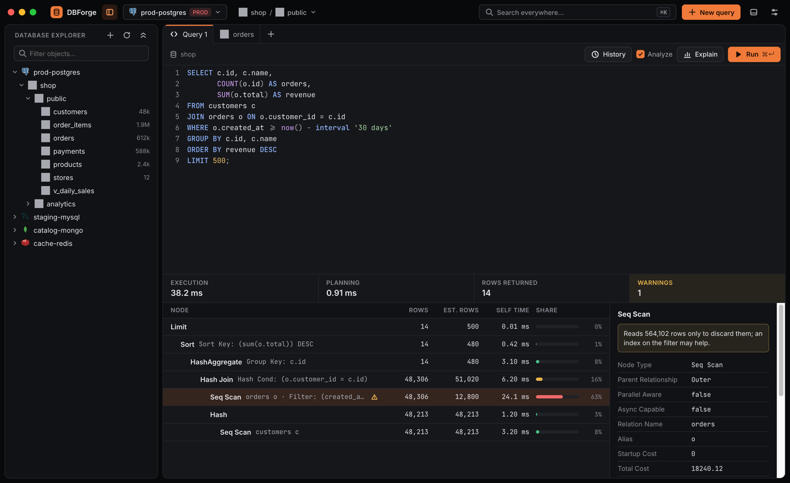</td>
    <td width="50%" valign="top"><b>Search everywhere</b> — jump to any table, view or command with ⌘K<br><br>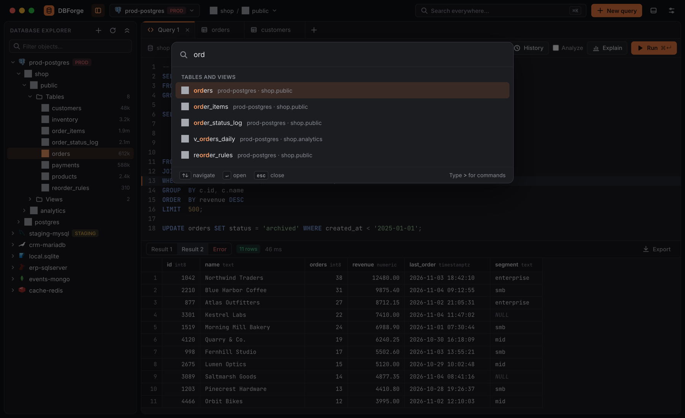</td>
  </tr>
</table>

### Documents and keys

<table>
  <tr>
    <td width="50%" valign="top"><b>MongoDB</b> — a collection as a grid or as its JSON documents<br><br>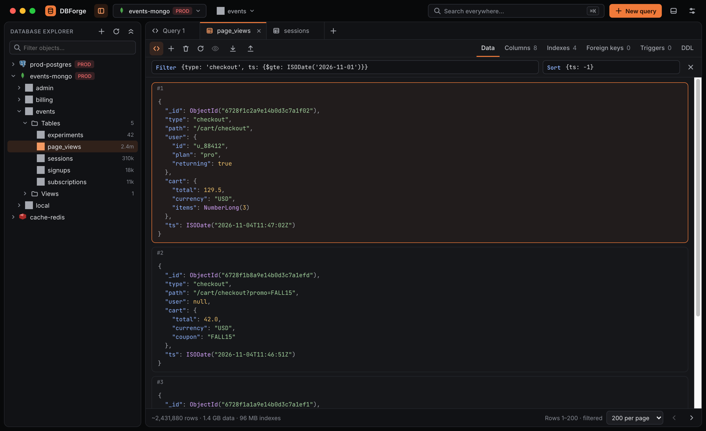</td>
    <td width="50%" valign="top"><b>Redis</b> — keys by pattern and type, as a tree or a list, with an editor per type<br><br>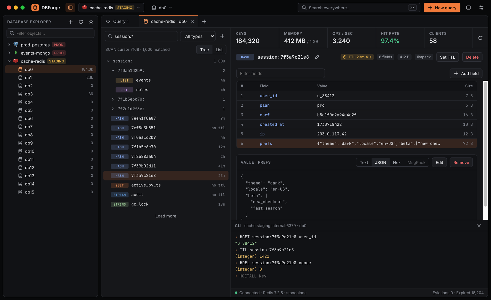</td>
  </tr>
</table>

### Move data in and out

<table>
  <tr>
    <td width="50%" valign="top"><b>Export</b> — a table or a result to CSV, TSV, JSON, SQL INSERT or Markdown, with the columns you pick<br><br>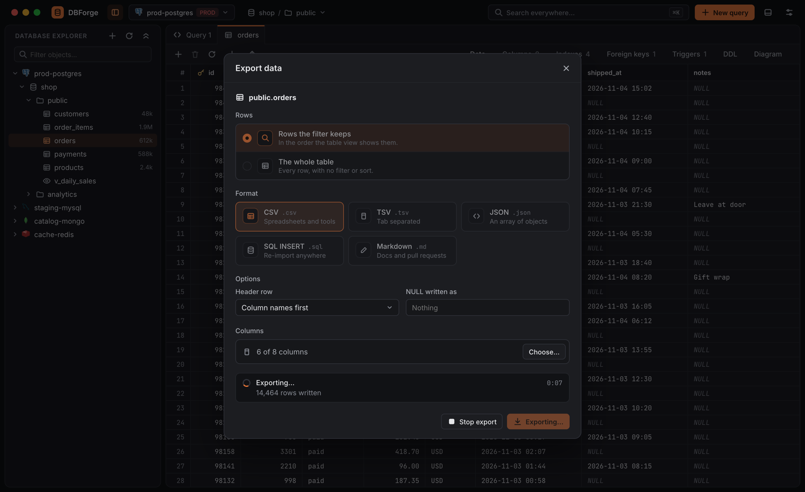</td>
    <td width="50%" valign="top"><b>Import</b> — rows from a CSV, TSV or JSON file, each field mapped to a column, in one transaction<br><br>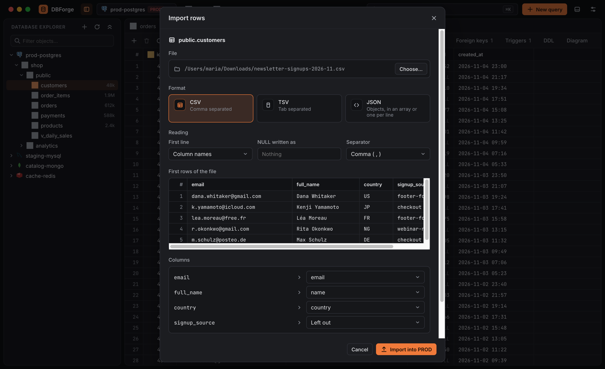</td>
  </tr>
</table>

### And more

<table>
  <tr>
    <td width="50%" valign="top"><b>Connections</b> — every engine in one dialog, tested before you save<br><br>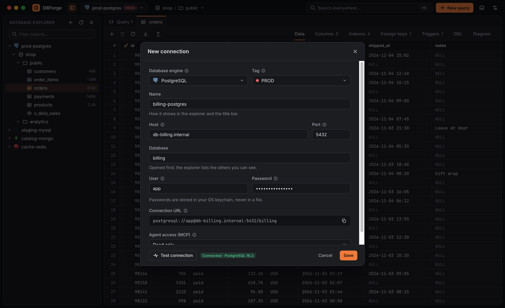</td>
    <td width="50%" valign="top"><b>Settings</b> — light or dark, English or Spanish, tags, AI agents, passwords and backups<br><br>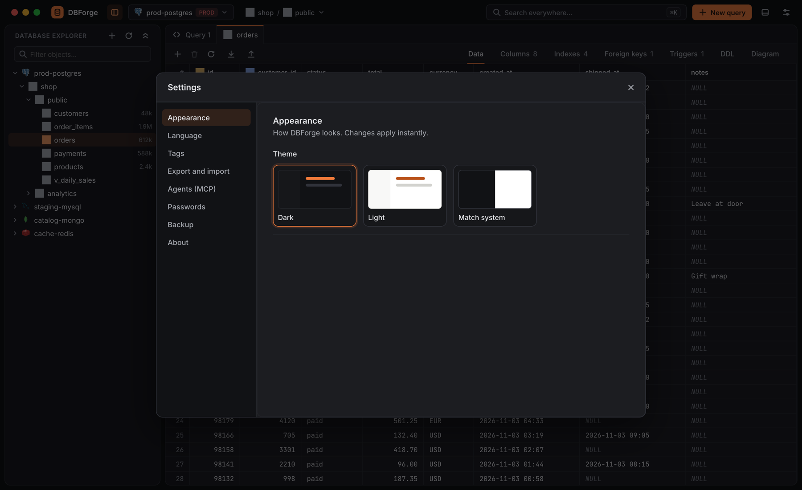</td>
  </tr>
</table>

Query history, a log of every statement DBForge sends, PostgreSQL dumps and restores, a backup of your whole setup, and an MCP server so AI agents can read, or with your approval change, the connections you allow.

## Build from source

You need Node.js 24 with pnpm, and Rust 1.90 or later.

```bash
pnpm install
pnpm tauri dev            # run the app from source
pnpm dev                  # run the UI in the browser, with sample data, at http://localhost:5173
```

```bash
pnpm test                 # frontend tests (Vitest)
pnpm lint                 # oxlint
cd backend && cargo test --lib   # backend tests; the ones that need database containers are ignored
```

```bash
scripts/make-dmg.sh       # build release/DBForge-<version>.dmg (needs dmgbuild)
```

Releases, signing and updates: [docs/RELEASING.md](docs/RELEASING.md).

### Structure

```
frontend/
  app/          The shell: the window, its tabs and dialogs
  components/   Reusable, feature-agnostic UI (Button, Modal, Select, data grid…)
  domain/       Core types shared across features (Connection, Engine, TableRef)
  features/     One folder per feature, with its components, logic and styles
  styles/       Design tokens (theme.css) and global base styles
backend/        Rust backend (Tauri): one driver per engine, and the commands the UI calls
scripts/        Release tooling: the DMG, its window, release notes and the update manifest
```

Conventions:

- Styles use CSS Modules next to each component; colors come only from the tokens in `styles/theme.css`.
- Pure logic lives outside components and is unit tested.
- A feature imports from `components/` and `domain/`, not from another feature.
