<p align="center">
  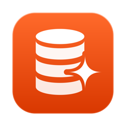
</p>

<h1 align="center">DBForge</h1>

<p align="center">
  A fast, lightweight desktop app for your databases.<br>
  PostgreSQL, MySQL, MariaDB, SQLite, SQL Server, MongoDB, Cosmos DB and Redis — in one window.<br>
  Query them, browse and edit their data, see their structure, and move data in and out.
</p>

<p align="center">
  <a href="https://github.com/Juan-Motta/dbforge/releases/latest">
    <picture>
      <source media="(prefers-color-scheme: dark)" srcset="docs/images/download-dark.svg">
      
    </picture>
  </a>
  <a href="https://github.com/Juan-Motta/dbforge/releases/latest">
    <picture>
      <source media="(prefers-color-scheme: dark)" srcset="docs/images/download-linux-dark.svg">
      
    </picture>
  </a>
  <a href="https://github.com/Juan-Motta/dbforge/releases/latest">
    <picture>
      <source media="(prefers-color-scheme: dark)" srcset="docs/images/download-windows-dark.svg">
      
    </picture>
  </a>
  <br>
  <sub>macOS, Linux and Windows · updates itself</sub>
</p>

<p align="center">
  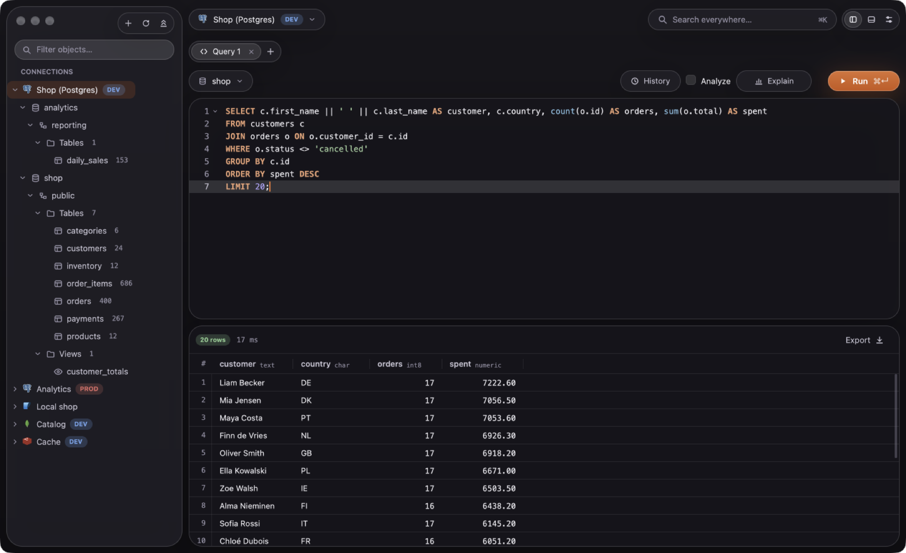
</p>

## Install

**macOS:** download `DBForge-x.y.z.dmg` from the [latest release](https://github.com/Juan-Motta/dbforge/releases/latest), open it and drag **DBForge** to **Applications**. It runs on Apple silicon and Intel Macs with **macOS 10.15.7** or later, signed and notarized by Apple.

**Linux (x86_64):** download `DBForge-x.y.z-amd64.AppImage`, make it executable (`chmod +x`) and open it. On Debian or Ubuntu you can install `DBForge-x.y.z-amd64.deb` instead (`sudo apt install ./DBForge-x.y.z-amd64.deb`). Both update themselves.

**Windows (x64):** download `DBForge-x.y.z-x64-setup.exe` and run it; it installs for your user and updates itself. It isn't code-signed yet, so Windows SmartScreen may warn the first time: choose **More info › Run anyway**.

## Works with your databases

| Database | What you get |
| --- | --- |
| **PostgreSQL** | Everything: the console with explain plans, table editing, structure and DDL, the ER diagram, and dumps and restores with `pg_dump` and `psql` |
| **MySQL** and **MariaDB** | The console, table editing, structure, DDL and the ER diagram, and dumps and restores with `mysqldump` and `mysql` (or `mariadb-dump` and `mariadb`) |
| **SQL Server** | The console, table editing, structure, DDL and the ER diagram |
| **SQLite** | The same, on a database file, and dumps to a SQL script or a copy of the file and restores, built in |
| **MongoDB** | Collections as rows or as JSON documents, a console that speaks mongosh, and dumps and restores with `mongodump` and `mongorestore` |
| **Cosmos DB** | Containers as rows or as JSON items, and a SQL console per container |
| **Redis** | A key browser by pattern and type, each type's editor, and a redis-cli console |

Reach servers through an **SSH tunnel** — with a password, a private key or your SSH agent — and choose how **SSL** is used: from off to verifying the server's certificate and name, with your own CA and client certificates. Passwords stay in the system's credential store (the macOS Keychain, Windows Credential Manager or the Secret Service on Linux), or in an encrypted file if you choose. Tag a connection as **PROD** and DBForge asks before anything changes it.

## Updates

DBForge tells you as soon as a new version is out (it looks every hour while open) and reminds you once a day after, with the release notes. **Install and Restart** downloads it, verifies its signature and relaunches. You can also check any time with **DBForge › Check for Updates…**, or turn the automatic check off in **Settings › About**.

## What you can do

### Query

A console per tab with highlighting and completion. Run the selection or the whole script, see each result in its own tab, with timing and row counts, and export or copy them. A script that stops partway still shows what its earlier statements did.

### Browse and edit tables

Filter and order rows, edit cells in place, add, duplicate and delete rows, and review the SQL before it runs. Pending changes apply in one transaction: all of them or none. Foreign keys open the row they point to.

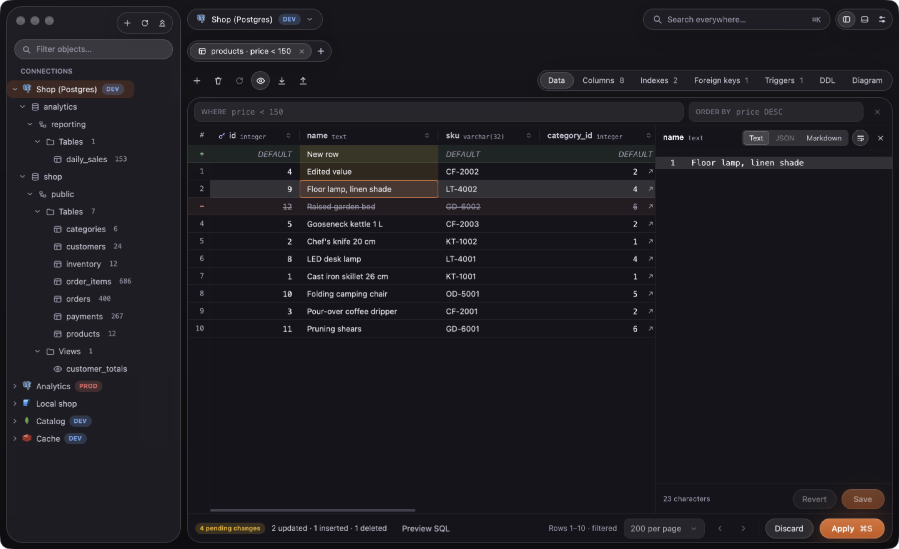

### Structure and relations

<table>
  <tr>
    <td width="50%" valign="top"><b>Structure</b> — columns, indexes, keys, triggers and the DDL that rebuilds the table<br><br>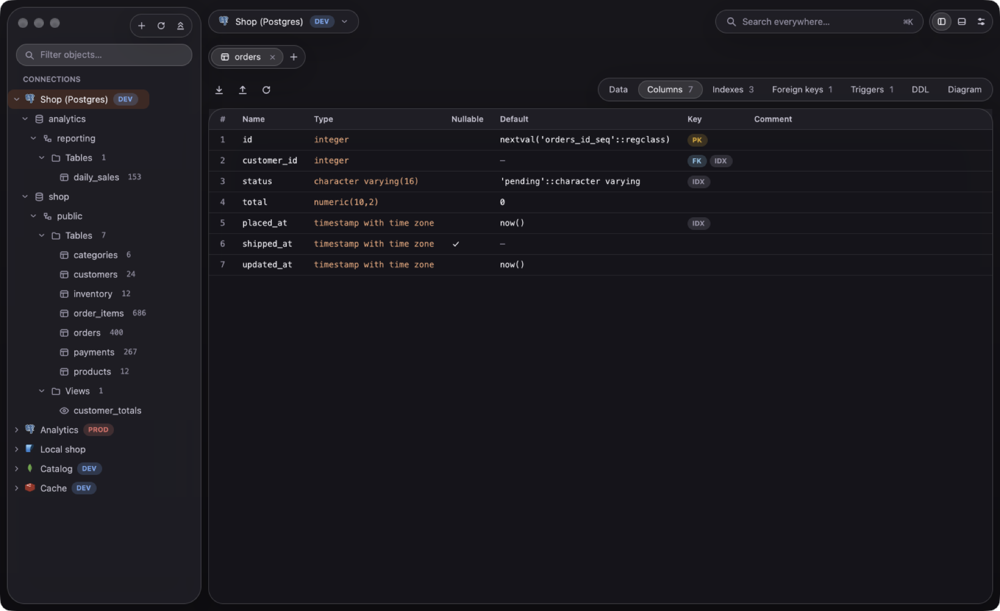</td>
    <td width="50%" valign="top"><b>ER diagram</b> — a schema's tables and the foreign keys between them<br><br>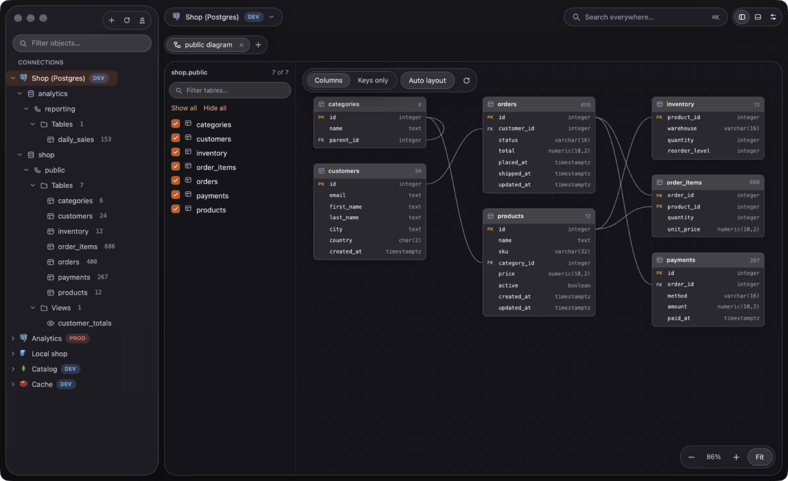</td>
  </tr>
  <tr>
    <td width="50%" valign="top"><b>Explain plans</b> — how a query runs, step by step, with its costs and timings<br><br>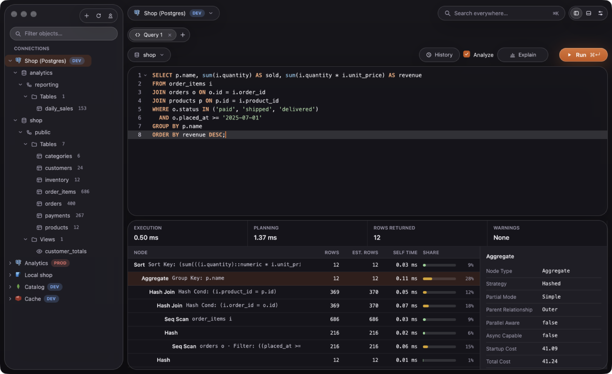</td>
    <td width="50%" valign="top"><b>Search everywhere</b> — jump to any table, view or command with ⌘K<br><br>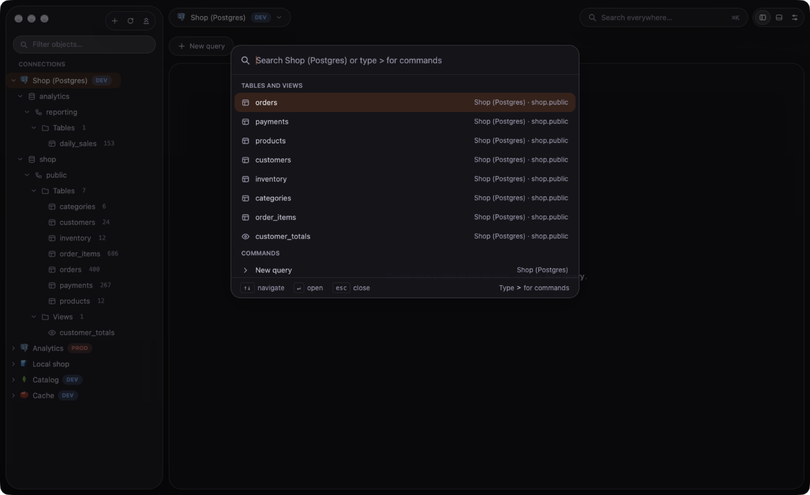</td>
  </tr>
</table>

### Documents and keys

<table>
  <tr>
    <td width="50%" valign="top"><b>MongoDB</b> — a collection as a grid or as its JSON documents<br><br>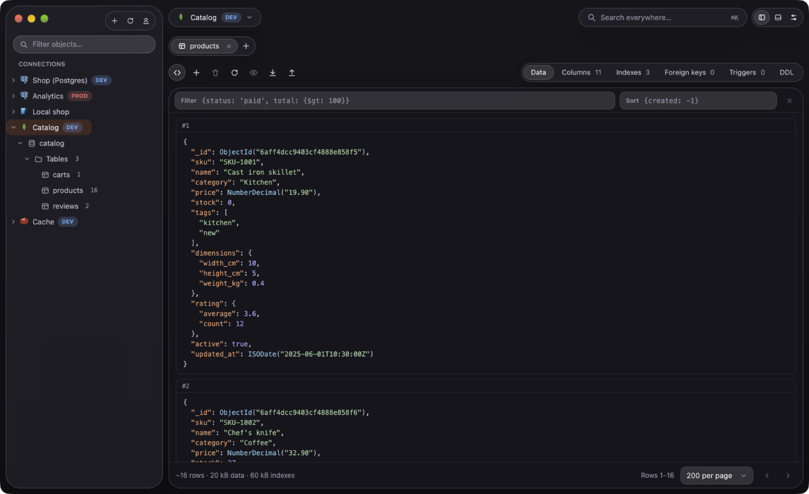</td>
    <td width="50%" valign="top"><b>Redis</b> — keys by pattern and type, as a tree or a list, with an editor per type<br><br>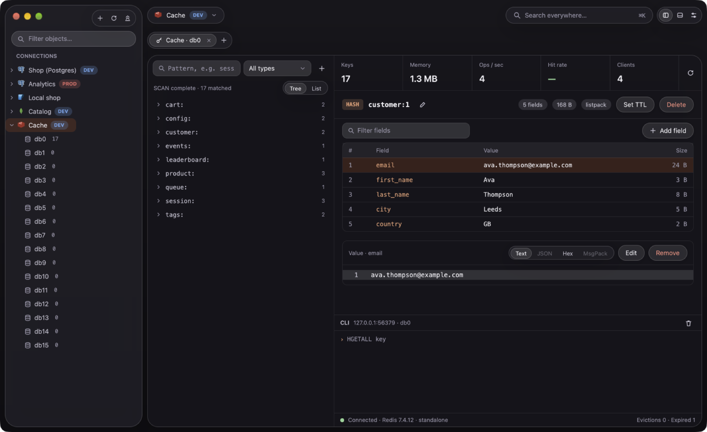</td>
  </tr>
</table>

### Move data in and out

<table>
  <tr>
    <td width="50%" valign="top"><b>Export</b> — a table or a result to CSV, TSV, JSON, SQL INSERT or Markdown, with the columns you pick<br><br>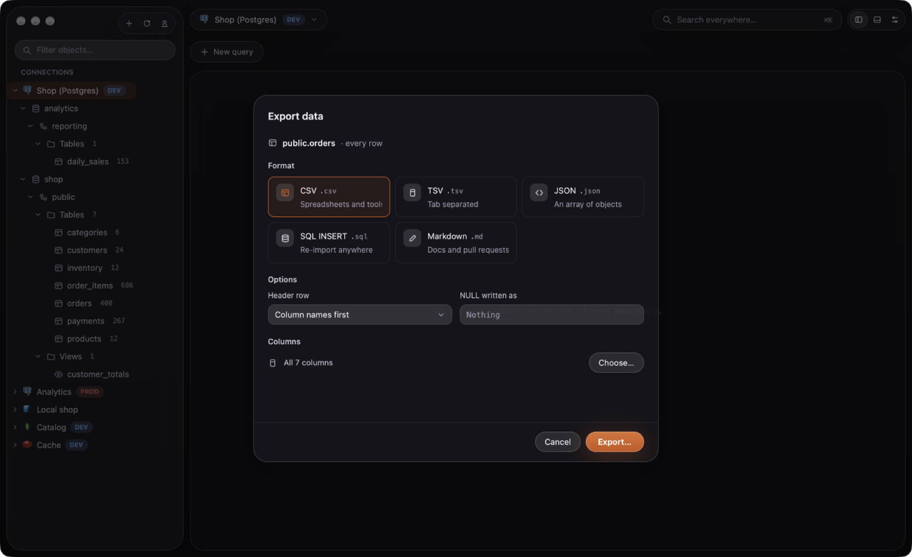</td>
    <td width="50%" valign="top"><b>Import</b> — rows from a CSV, TSV or JSON file, each field mapped to a column, in one transaction<br><br>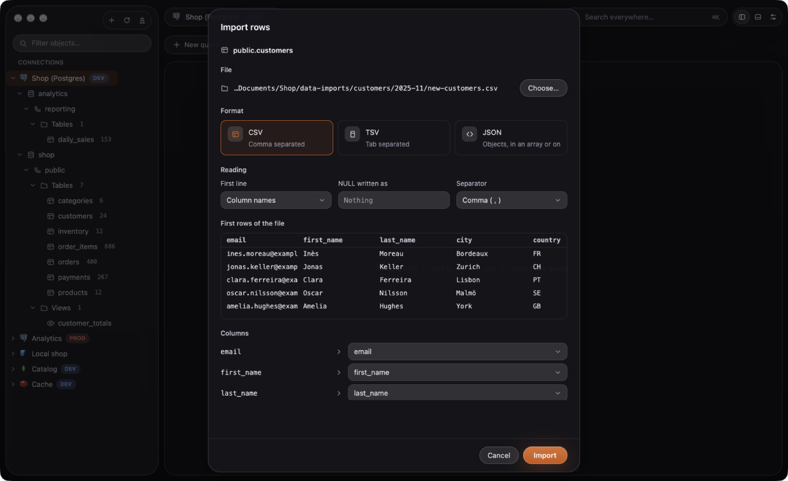</td>
  </tr>
</table>

### And more

<table>
  <tr>
    <td width="50%" valign="top"><b>Connections</b> — every engine in one dialog, tested before you save<br><br>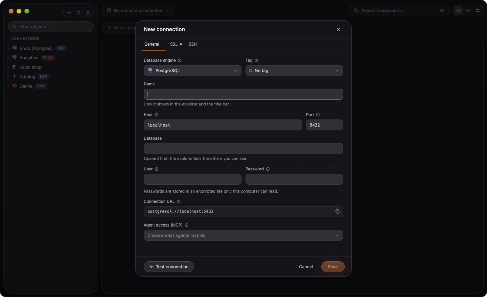</td>
    <td width="50%" valign="top"><b>Settings</b> — light or dark, English or Spanish, tags, AI agents, passwords and backups<br><br>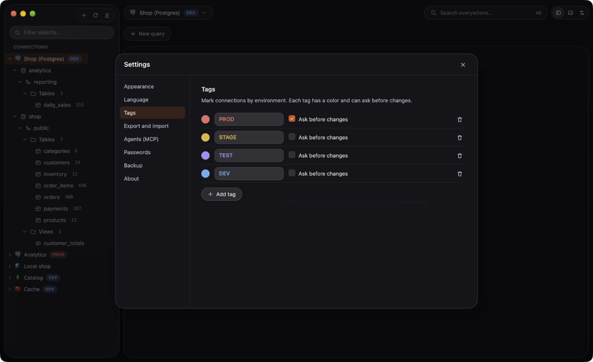</td>
  </tr>
</table>

Query history, a log of every statement DBForge sends, dumps and restores of whole databases (PostgreSQL, MySQL, MariaDB, MongoDB and SQLite), a backup of your whole setup, and an MCP server so AI agents can read, or with your approval change, the connections you allow.

### Use it from an AI agent

Turn on **Settings → Agents (MCP)**, pick your agent and copy its command. By default the agent starts DBForge's own executable with `--mcp-stdio` and keeps it for its whole session: it reconnects by itself when DBForge opens or restarts, works the same on macOS, Windows and Linux, and its settings hold no token. While DBForge is closed, a tool call answers that the app needs to be open. Agents that only take HTTP servers can use `http://127.0.0.1:7419/mcp` with the token instead.

Agents also reach your saved queries on the connections they may use: they list them, run them with values for their `:name` parameters, and create, edit or delete them once you approve each change in DBForge.

They can also back up a whole database (`export_database`) and restore one of those backups (`import_database`, with `list_exports` to see them), for every engine with dumps. Backups go only into DBForge's exports folder, under a name DBForge gives them, and restores read only from there. A backup needs the connection's Read access, a restore Read and write; DBForge asks you to approve every one first, showing the database, the connection, the file and the options.

## Build from source

DBForge is a native Rust app: its window is drawn with [GPUI](https://www.gpui.rs). You need Rust 1.90 or later
([rustup](https://rustup.rs)) and, per system:

- **macOS:** the Xcode Command Line Tools (`xcode-select --install`). The Metal shaders compile when the app
  starts, so the full Xcode isn't needed.
- **Linux (Debian or Ubuntu):** the libraries GPUI builds against:

  ```bash
  sudo apt-get install -y build-essential pkg-config cmake clang libfontconfig-dev libfreetype-dev \
    libwayland-dev libx11-xcb-dev libxkbcommon-dev libxkbcommon-x11-dev libvulkan-dev
  ```

- **Windows:** the Visual Studio Build Tools with the "Desktop development with C++" workload (the MSVC
  compiler and the Windows SDK).

```bash
cargo run -p dbforge              # run the app from source
cargo run -p dbforge --release    # the same, optimised
```

The executable also serves AI agents over stdio with `--mcp-stdio` (see above).

### Tests and checks

```bash
cargo test --workspace --lib                         # unit tests
cargo clippy --workspace --all-targets -- -D warnings
cargo fmt --all --check
```

Tests that need a real database are ignored by default; each names the server and port it expects (for
example a PostgreSQL on port 55432). Start those servers, for instance in Docker, and run
`cargo test --workspace --lib -- --ignored`. `scripts/test-tls-certs.sh` makes the certificates the TLS tests use.

### Packages and releases

`scripts/make-app.sh` builds the Mac app, `scripts/make-dmg.sh` the DMG, `scripts/make-linux.sh` the AppImage and
the .deb, and `scripts/make-windows.sh` the Windows installer, all into `release/`. How a version is signed,
notarized, published and updated: [docs/RELEASING.md](docs/RELEASING.md).

### Structure

```
crates/
  core/       dbforge-core: the logic, with no UI. One driver per engine, connections, credentials,
              SSH tunnels, queries, edits, export and import, dumps, backups, history, the statement
              log, and the MCP server with its stdio bridge
  app/        dbforge: the GPUI app. One module per feature (explorer, query, table, structure,
              diagram, keyspace, palette, settings, export, import, dump, backup, mcp, updates…),
              reusable controls in ui/, texts in English and Spanish in i18n/, colours in theme.rs
  release/    dbforge-release: signs and verifies the updater's packages
packaging/    Icons, the macOS Info.plist, the Linux .desktop and .deb control, the Windows NSIS script,
              and the updater's public key
scripts/      Packaging and release tooling
docs/         Releasing, and the README's images
```

Conventions:

- Pure logic lives outside the views and is unit tested; views only draw and dispatch.
- The UI never blocks on the database: core calls run off the UI thread, and a late answer to an outdated
  request is dropped.
- Every text the UI shows is in `crates/app/src/i18n`, in both languages; colours come only from `theme.rs`.
- Configuration and data live where earlier versions kept them (identifier `dev.dbforge.app`), in the same
  formats, so an update keeps everything.

### Development hooks

These environment variables help while working on the app:

| Variable | What it does |
| --- | --- |
| `DBFORGE_DIR` | Keeps the configuration and data in `$DBFORGE_DIR/config` and `$DBFORGE_DIR/data` instead of the installed app's folders, so a development run never touches your real connections |
| `DBFORGE_OPEN` | Debug builds: opens a view or dialog at start, such as `settings#agents`, `palette`, `query:<connection id>#history` or `table:<connection id>/<path>#edits` (the full list is on `Shell::open_for_development` in `crates/app/src/shell/mod.rs`) |
| `DBFORGE_SQL`, `DBFORGE_KEY` | Debug builds: the script a `DBFORGE_OPEN` console runs, the Redis key a key browser selects |
| `DBFORGE_FILTER`, `DBFORGE_ORDER` | Debug builds: the `WHERE` (or MongoDB filter) and `ORDER BY` (or sort) a `DBFORGE_OPEN=table:…` opens its rows with |
| `DBFORGE_PICK` | Debug builds: the path file dialogs answer with, instead of asking |
| `DBFORGE_EXPAND` | Debug builds: connection ids (comma-separated, or `all`) whose whole tree opens at start |
| `DBFORGE_UPDATE_ENDPOINT`, `DBFORGE_UPDATE_PUBKEY`, `DBFORGE_UPDATE_INSTALL_PATH` | Debug builds: try the updater against a local manifest (see [docs/RELEASING.md](docs/RELEASING.md)) |
